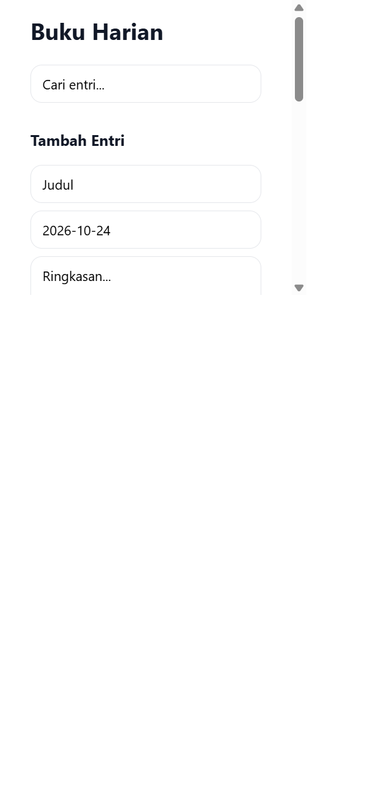
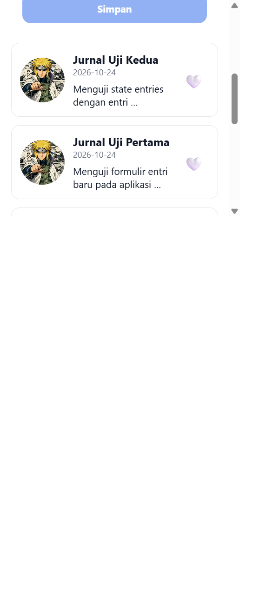
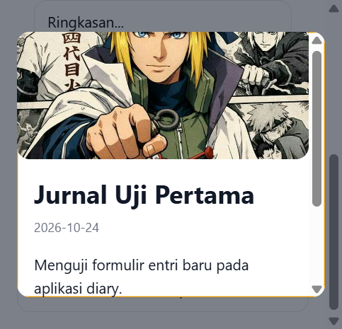

# Diary App

## Identitas

- Nama: Asep Hikmat Miptahudin
- NIM: 2430511015

## Menjalankan aplikasi

1. Pastikan Node.js dan npm sudah terpasang.
2. Jalankan `npm install` dari folder project.
3. Jalankan `npx expo start`.
4. Tekan `w` untuk membuka versi web, atau pindai QR code dengan Expo Go.

## Props dan state

- `DiaryCard` menerima objek `entry`, status `liked`, serta callback `onPress` dan `onToggleLike` melalui props. Komponen ini menampilkan data tanpa mengelola state entri sendiri.
- `SearchBar` mengelola teks pencarian lokal dan mengirim perubahan ke parent melalui callback `onChange`.
- `EntryForm` mengontrol nilai judul, tanggal, dan ringkasan dengan state lokal; ketika disimpan, data baru dikirim melalui `onSubmit`.
- `DiaryListScreen` menjadi pemilik state `entries`, `query`, `likedIds`, dan `selected`. State ini mengatur hasil pencarian, perubahan like langsung, entri baru, serta modal detail.
- Gambar mood menggunakan aset lokal di `assets/moods`.

## Screenshot pengujian

### Sebelum perubahan state

### Setelah menambahkan entri

### Pencarian

### Like

### Modal detail

Dua entri uji ditambahkan melalui form selama pengujian.
